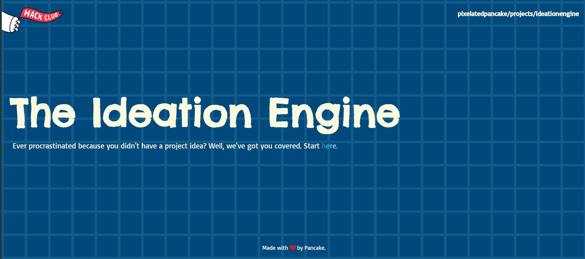
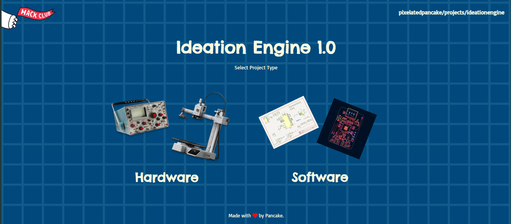
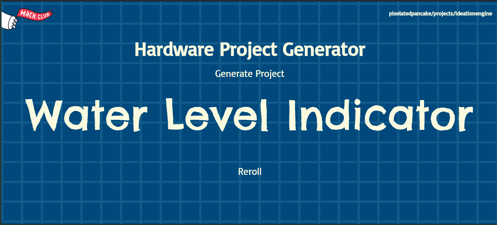
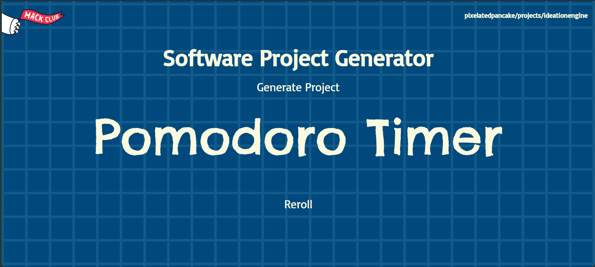

# Project-Idea-Website
Website that gives you project ideas with HTML, CSS, and JavaScript.

## I. Information

- This is a website that gives you project ideas, for whenever you feel stuck
- You can select between hardware and software projects
- You can reroll and browse through 100 projects

## II. Tech Stack

- Used HTML, CSS, and a little bit of JS.
- Hosted on Vercel

## III. Problems I Faced

- Pretty smooth, just faced a few problems with image positioning
- For the next website I made, I'll probably have to learn to make the website adapt smoothly to various aspect ratios

# IV. Demo Link

- Try it out at https://ideationengine.vercel.app/index.html

# V. Image Gallery

# VI. AI Disclosure

- A little bit of AI was used when my code wasnt working and I needed debugging, though I didnt copy it direcly. AI was used to generate the project ideas as well.

# VII. Fun Facts

- Try clicking the hack club logo, the text that says pixelatedpancake/projects/ideationengine, and the word "Pancake" in the footer.
- There's also an error page, click this link to see it: https://ideationengine.vercel.app/softwawvdsre.html